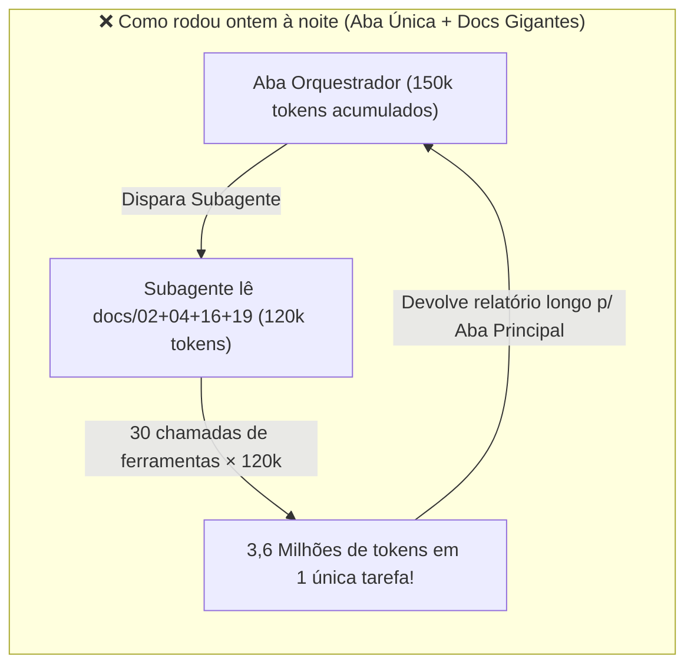
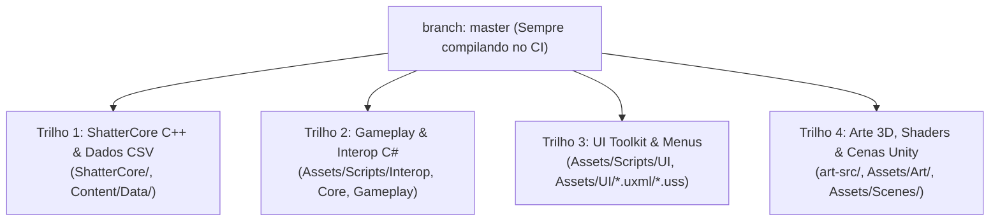

# Guia de Arquitetura de IA, Controle de Contexto e Trabalho em Dupla — *Echoes of the Shatter*

> [!IMPORTANT]
> **Resumo Executivo para Alinhamento da Dupla (Leo & William):**
> O projeto possui uma **excelente arquitetura técnica** (`ShatterCore` C++17 isolado + CSVs validados + `Unity 6.3` via P/Invoke). O gargalo atual **não está no código**, mas na **gestão da janela de contexto dos agentes**:
> 1. Manter uma **única aba como Orquestrador por várias horas** faz cada comando reenviar 150k+ tokens acumulados e causa *Context Rot* (degradação de memória após *auto-compaction*).
> 2. A pasta `docs/` acumulou **968 KB (~250.000 tokens)** só na raiz. Quando subagentes recebem ordens para ler `docs/03` (95 KB), `docs/04` (100 KB), `docs/16` (95 KB) e `docs/19` (94 KB), cada subagente nasce carregando ~100k tokens na memória.
> 3. Na madrugada de 18/10, rodando no piloto automático, o próprio Orquestrador passou a aprovar artes e decisões de design sozinho (`aprovadas pelo orquestrador` nos commits `72e0086`, `3a76f4c`, `dffbee2`), furando a trava humana do `CLAUDE.md`.

---

## 1. Diagnóstico em Números: Para Onde Foram os Limites do Claude?

### 1.1 O Peso Atual da Pasta `docs/` (Quase 1 MB de Texto)

| Arquivo em `docs/` | Tamanho | Tokens Estimados | Problema Atual |
|---|---:|---:|---|
| `docs/tecnico/04_arquitetura.md` | 100,5 KB | ~26.000 tokens | Lido inteiro por quase todo subagente de código |
| `docs/arte/03_design_system.md` | 95,4 KB | ~25.000 tokens | Lido inteiro por subagentes de UI e Arte |
| `docs/design/16_etapa3_fluxo.md` | 95,1 KB | ~25.000 tokens | Gerado e relido inteiro nas tarefas da Etapa 3 |
| `docs/design/19_itens_e_habilidades.md` | 94,9 KB | ~25.000 tokens | Gerado na madrugada de 18/10 (~25k tokens de saída!) |
| `docs/requisitos-qa/10_qa.md` | 79,9 KB | ~21.000 tokens | Matriz completa lida a cada rodada de QA |
| `docs/tecnico/06_dados.md` | 74,8 KB | ~19.500 tokens | Lido inteiro pelos agentes de Dados e Narrativa |
| `docs/design/00_plano_existente.md` | 57,2 KB | ~15.000 tokens | Contém histórico antigo de Godot e Pixel Art |
| `docs/tecnico/09_mudancas_contrato.md` | 48,9 KB | ~13.000 tokens | Histórico acumulado de contratos da API C |
| `docs/design/13_design_pendencias.md` | 47,7 KB | ~12.500 tokens | Histórico de decisões já tomadas |
| `docs/design/18_combate_combo.md` | 47,2 KB | ~12.500 tokens | Gerado em 17/10 com todas as linhas de CSV |
| `progresso/estado.json` | 46,5 KB | ~12.000 tokens | Lido e reescrito a cada atualização do painel |
| **Total na raiz de `docs/`** | **968,3 KB** | **~250.000 tokens** | **Maior que a janela inteira de 200k do Claude!** |

### 1.2 O Efeito Multiplicador na Cota de Uso


---

## 2. O Novo Fluxo: Sessões Efêmeras + Cartões de 5 KB + Trilhos Paralelos

### 2.1 Regra #1: O Ciclo de Vida de um Chat ("1 Chat = 1 Pacote de 30–90 min")
Você **não** usa um único chat eterno e **não** abre um chat manual para cada linha de código. A unidade de trabalho é o **Pacote de Entrega**:

1. **Abrir Chat Novo (0 tokens de histórico):**
   - Comando inicial curto: *"Leia `CLAUDE.md` e `docs/progresso/fila_ativa.md`. Vamos executar o Pacote [ID] na branch `etapa3/<frente>`."*
2. **Planejamento Rápido e Briefs Cirúrgicos:**
   - O agente principal verifica apenas os arquivos do pacote e cria um *brief* curto (máx. 1–2 KB) para cada subagente.
3. **Execução por Subagentes Isolados:**
   - Cada subagente lê **apenas**: o seu *brief* + o **Cartão de Contexto da sua camada (`≤ 5 KB`)** + os arquivos `.cpp`/`.cs`/`.csv` que vai editar.
   - O subagente roda os testes (`ctest`, `validate_data.py` ou Unity CLI), faz o commit e responde ao agente principal em **no máximo 5 linhas** (`Status | Commit | Teste | Arquivos`).
4. **Fechamento e Descarte da Aba (`/clear` ou Fechar Chat):**
   - Terminou o pacote e enviou para o GitHub? **Feche o chat.** A memória real está no Git e no `fila_ativa.md`. O próximo pacote começa com cérebro 100% fresco e custo mínimo.

### 2.2 Regra #2: Os 4 "Cartões de Contexto" (`docs/contexto/*.md`)
Em vez de ler os documentos de 95 KB de ponta a ponta, criamos a pasta `docs/contexto/` com 4 arquivos enxutos (máx. 5 KB / ~150 linhas cada):

| Cartão de Contexto (≤ 5 KB) | Quem lê | O que contém (e o que fica de fora) |
|---|---|---|
| `docs/contexto/core_cpp.md` | Backend, Integração, QA | Regras de determinismo C++17, flags `-Werror` do GCC/Clang (`-Wmissing-field-initializers`, `-Wtype-limits`, `-Wrange-loop-construct`), convenções de `shatter_c.h` e comando `tools\core\build_core.cmd`. |
| `docs/contexto/dados_csv.md` | Data Engineer, Narrative | Lista das tabelas CSV atuais, formato de cabeçalhos, regras de IDs em inglês, ponto decimal obrigatório e uso do `python tools/dados/validate_data.py`. |
| `docs/contexto/unity_csharp.md` | Frontend, UI, Code Reviewer | Grafo de `asmdefs` (`Echoes.Interop`, `Core`, `Gameplay`, `Presentation`, `UI`), proibições (`MaterialPropertyBlock`, `Time.timeScale`, cálculo de regra em C#, strings literais) e uso de `tokens.uss` + `LocLabel`. |
| `docs/contexto/arte_3d.md` | Art Director, Arte Técnica | Câmera de 56m (pitch 55°, yaw 45°, FOV 14,2°), régua de escala (88px em 1080p), orçamentos de triângulos/ossos e pipeline Blender → FBX no Git LFS. |

> [!TIP]
> **E os documentos grandes (`docs/00` a `docs/19`)?**
> Eles continuam no repositório como **Enciclopédia de Referência**. Se um agente precisar consultar os números da seção `4.5` do `docs/design/16_etapa3_fluxo.md`, ele usa `grep` para achar a linha exata e lê apenas 60 linhas (`StartLine`/`EndLine`), **nunca o arquivo inteiro de 95 KB**.

### 2.3 Regra #3: Seleção de Modelos por Papel (Economia de 70%+ da Cota)

| Tipo de Tarefa | Modelo no Claude Code | Modelo no Antigravity | Por quê |
|---|---|---|---|
| `guardiao-github`, checagem de Git/LFS, scripts simples | **Haiku 4.5** | **Flash Lite / Flash** | Tarefa mecânica de terminal; gastar Opus/Pro aqui queima limite à toa. |
| Implementação C++/C# com regra já especificada, CSVs, `painel-progresso`, UI Toolkit | **Sonnet 4.5 / 5.5** | **Flash / Padrão** | Como a especificação já traz as fórmulas e colunas, a tarefa é tradução + testes. |
| Arquitetura de contrato novo, debugging complexo de memória/UB, Code Review final de branch | **Opus** | **Gemini Pro / Argon (High)** | Reservado apenas para decisões difíceis e revisão final antes do merge no `master`. |

---

## 3. Como Trabalhar em Dupla (Leo + William) Sem Conflitos de Arquivo

### 3.1 Divisão por "Trilhos Ortogonais"
O maior perigo em projetos Unity com 2 pessoas + IA é dois agentes editarem a mesma Cena (`.unity`), Prefab (`.prefab`) ou recompilarem a `shattercore.dll` ao mesmo tempo. Para blindar o projeto:



- **Regra da DLL (`shattercore.dll`):** Enquanto uma branch de feature do Trilho 1 estiver em desenvolvimento, valide tudo pelo `ctest` em C++. Só gere e faça commit do binário `EchoesOfTheShatter/Assets/Plugins/x86_64/shattercore.dll` no commit final da entrega (ou deixe apenas um responsável gerar a DLL ao integrar no `master`).
- **Regra de Cenas e Prefabs:** Apenas **uma pessoa por vez** pode estar com um pacote ativo que altere `.unity` ou `.prefab`.

### 3.2 O Arquivo Semáforo: `docs/progresso/fila_ativa.md`
Adicione este arquivo leve na raiz de `docs/progresso/` (e referencie no `CLAUDE.md` e `AGENTS.md`). Ele funciona como o "quadro de controle" para vocês dois e para as IAs:

```markdown
# Fila Ativa de Produção (Semáforo da Dupla)

Regras para Humanos e Agentes:
1. Antes de iniciar qualquer pacote, dê `git pull origin master` e verifique a tabela "Em Execução Agora".
2. NUNCA toque nos arquivos/pastas listados em uma frente que já está com outro dono.
3. Ao assumir um pacote da fila, mova-o para "Em Execução Agora" com seu nome (`William` ou `Leo`) e a branch, e faça `git push`.

## 🟢 Em Execução Agora (Locks Ativos)
| ID | Pacote | Dono | Branch | Pastas Bloqueadas (Lock) | Status |
|---|---|---|---|---|---|
| P-01 | Integração Core Etapa 3 (API 1.5 a 1.7) | William | `etapa3/economia` | `ShatterCore/`, `Content/Data/`, `Assets/Scripts/Interop/` | Pronto p/ revisão e merge |
| P-02 | Folhas de modelagem NPCs Refúgio | William | `master` | `docs/arte/`, `art-src/` | Aguardando revisão humana |

## 📋 Próximos Pacotes Prontos para Puxar
| ID | Pacote | Trilho | Pastas Tocadas | Depende de |
|---|---|---|---|---|
| P-03 | Testes finais do Core (M8 do `docs/17`: fichas de ataque e explosão do Volátil no idle) | Trilho 1 (C++) | `ShatterCore/tests/` | Independente |
| P-04 | Ligar API C 1.5 no Gameplay C# (combo de 3 golpes, ataque forte carregado, defesa perfeita e rampa de movimento) | Trilho 2 (C# Gameplay) | `Assets/Scripts/Gameplay/`, `Assets/Scripts/Core/` | Merge da `etapa3/economia` |
| P-05 | Ligar API C 1.6 na UI/Refúgio (Telas e NPCs de Vendedor, recompra, Frasco de Recarga e Encantador) | Trilho 3 (C# UI) | `Assets/Scripts/UI/`, `Assets/UI/` | Merge da `etapa3/economia` |
| P-06 | Ligar API C 1.7 na Cripta (Baús persistentes, encontros, XP, Fervor e tempo real da arma no combate) | Trilho 2 (C# Gameplay) | `Assets/Scripts/Gameplay/` | Merge da `etapa3/economia` |
| P-07 | Higienização da documentação e criação dos Cartões de Contexto (`docs/contexto/`) | Docs | `CLAUDE.md`, `AGENTS.md`, `docs/01`, `docs/contexto/` | Independente |
```

---

## 4. Raio-X do Repositório Hoje (18/10/2026): O Que Está Acontecendo Agora?

Ao inspecionar as 3 branches do GitHub (`master`, `etapa3/combate-core` e `etapa3/economia`), descobrimos algo importantíssimo para vocês organizarem o trabalho de hoje:

### 4.1 Situação Real das Branches no GitHub
1. **`etapa3/combate-core` (7 commits à frente do `master`):**
   - Implementou os dados e a **API C 1.5** (combo básico, kits de Arqueiro/Mago, defesa com arco, `pierce`, `shatter_resolve_hit_charged`, `explosionRadius` / `KnockbackUu`).
   - **Atenção:** Todos os 7 commits desta branch **já estão dentro de `etapa3/economia`**! Ou seja, quando `etapa3/economia` for para o `master`, a `etapa3/combate-core` já estará 100% incluída e poderá ser limpa.
2. **`etapa3/economia` (18 commits à frente do `master`, apenas 2 commits de arte atrás do `master`):**
   - Foi onde o agente trabalhou pesado durante a madrugada de hoje (18/10 até 05h50 UTC) e **o CI do GitHub Actions passou com sucesso (`conclusion=success`)**!
   - Ela já entregou no **C++ (`ShatterCore`)**, nos **CSVs (`Content/Data`)** e no **P/Invoke (`Echoes.Interop`)**:
     - **API C 1.5:** Kits de classe, combo, ataque carregado, defesa com arco e perfuração.
     - **API C 1.6:** Economia do protótipo, Vendedor, recompra, Frasco de Recarga e Encantador.
     - **API C 1.7:** Estado do mundo no save, baús, encontros da Cripta, XP, Fervor, `attackTime` da arma e rampa de aceleração/desaceleração do herói (`hero_move_accel_seconds` / `decel_seconds`).
   - **O que falta para fechar essa frente?** O motor C++, os CSVs e a ponte `Echoes.Interop` já estão prontos na `etapa3/economia`, mas **falta ligar tudo isso nos scripts C# de Gameplay e UI da Unity** (`Pacotes P-04, P-05 e P-06` da tabela acima)!

### 4.2 Decisões Tomadas pelo "Orquestrador" na Madrugada (Revisar!)
Como o agente ficou rodando sozinho à noite, ele próprio aprovou itens que o `CLAUDE.md` exige que passem por vocês. Vale vocês dois darem um "de acordo" rápido nestes 4 commits recentes do `master`:
- `de0b6a2`: Decisões de combo, ataque forte, defesa e kits do Arqueiro/Mago em `docs/design/18_combate_combo.md`.
- `72e0086` e `812cfdd`: Folha de modelagem do conjunto Raro do Guerreiro (`m10`, aço claro com frisos dourados).
- `3a76f4c`: Especificação de itens e habilidades do Ato I em `docs/design/19_itens_e_habilidades.md`.
- `dffbee2`: Folhas de modelagem dos 4 NPCs do Refúgio (Ilsa, Tico, Vendedor, Encantador).

### 4.3 Limpezas Recomendadas no Repositório
- **`docs/requisitos-qa/01_plano_execucao.md` e `docs/requisitos-qa/07_proximos_passos.md`:** Ainda mencionam **Unreal Engine 5** e prompts antigos que mandam os agentes lerem dezenas de arquivos. Devem ser atualizados ou marcados como `[HISTÓRICO]` no topo.
- **Arquivos do protótipo antigo em Godot na raiz (`project.godot`, `core/`, `game/`, `scenes/`):** Embora documentados como histórico, pastas chamadas `core/` e `scenes/` na raiz confundem buscas por `glob`/`grep` dos agentes. Movê-las para uma subpasta `_historico_godot/` evita que subagentes leiam arquivos `.gd` por engano e gastem tokens.
- **Compatibilidade Dupla (`CLAUDE.md` + `AGENTS.md`):** Criar um arquivo `AGENTS.md` na raiz apontando para o `CLAUDE.md` (ou espelhando as regras de contexto enxuto), para que tanto o **Claude Code** (William) quanto o **Antigravity** (Leo) sigam exatamente o mesmo protocolo.

---

## 5. Passo a Passo Prático: Como Começar Agora Mesmo

1. **Alinhar com o William (10 min):**
   - Mostre a tabela da **Seção 1.1** (os 968 KB da pasta `docs/`) e explique a mudança para **1 Chat por Pacote (30–90 min)** + **Cartões de Contexto de 5 KB**.
   - Revisem juntos os 4 commits que o Orquestrador auto-aprovou de madrugada (Seção 4.2) e façam o merge da branch `etapa3/economia` no `master` (já que ela contém a `combate-core` e está com o CI verde).
2. **Aplicar a Blindagem de Contexto no Repositório (`Pacote P-07`):**
   - Criar `docs/progresso/fila_ativa.md` e os 4 arquivos de `docs/contexto/*.md`.
   - Adicionar no topo do `CLAUDE.md` as **Regras de Economia de Contexto e Trava de Aprovação Humana** (bloco abaixo).
3. **Dividir os Próximos Pacotes entre Vocês Dois:**
   - **Frente A (ex.: Você):** Puxar o `Pacote P-07` (arrumação do contexto) e em seguida o `Pacote P-04` ou `P-05` (ligar Vendedor/Encantador ou Combate/Combo no C# da Unity) ou `P-03` (testes isolados pendentes do C++ em `ShatterCore/tests/`).
   - **Frente B (ex.: William):** Continuar o pipeline de Arte 3D / Cenas da Cripta e Refúgio (`Trilho 4`) ou dividir um dos pacotes de C# com você pelo `fila_ativa.md`.

### Bloco Pronto para Adicionar ao `CLAUDE.md` (e `AGENTS.md`)

```markdown
## Economia de Contexto e Orquestração de Agentes (Obrigatório)
- **Proibido ler `docs/` monolíticos inteiros:** A pasta `docs/` possui ~1 MB. Subagentes NUNCA devem ler `docs/00`, `02`, `03`, `04`, `06`, `10`, `16`, `18` ou `19` inteiros. Leia primeiro o cartão resumido da camada em `docs/contexto/` (`core_cpp.md`, `dados_csv.md`, `unity_csharp.md`, `arte_3d.md`, máx. 5 KB cada) e use `grep`/leitura por faixa de linhas apenas para a seção específica necessária.
- **1 Sessão = 1 Pacote de Entrega:** Priorize fechar um pacote coeso de `docs/progresso/fila_ativa.md`, fazer commit/push e encerrar a sessão para evitar acúmulo de contexto e auto-compaction.
- **Briefs enxutos para Subagentes:** Ao chamar um subagente, passe apenas o objetivo da tarefa, os arquivos exatos a tocar e as restrições da camada. O subagente deve responder ao controlador em no máximo 5 linhas (Status, Commits, Resumo dos Testes, Arquivos Alterados).
- **Trava Humana Absoluta (Modo Noturno/Autônomo):** O Orquestrador NUNCA tem permissão para aprovar artes em nome do dono nem converter itens `[HIPÓTESE]` ou `pendencias_dono` em decisão final. Se uma frente depender de aprovação humana, pare a frente, registre em `estado.json` e passe para outra tarefa técnica independente.
- **Sincronização da Dupla:** Sempre consulte e atualize `docs/progresso/fila_ativa.md` antes de iniciar uma frente para não tocar em pastas ou branches bloqueadas pelo outro desenvolvedor.
```


---

## 6. Diagnóstico de Escopo e Velocidade: 2.140 Arquivos em 45 Horas ("Atacar Tudo de Uma Vez" vs. "Fatia Vertical")

### 6.1 O Que Aconteceu nas Primeiras 45 Horas do Repositório?
O repositório foi criado em **16/10/2026 às 14h52 UTC**. Em menos de dois dias, já existem no `master`:
- **2.140 arquivos no total:**
  - **1.463 arquivos** em `EchoesOfTheShatter/Assets/` (697 arquivos reais + 766 `.meta` da Unity), incluindo **252 scripts C# (`.cs`)**, **88 modelos `.fbx`** e **60 materiais**.
  - **179 arquivos** no `ShatterCore/` (20 headers `.h`, 20 `.cpp` e 138 arquivos de teste/fixtures).
  - **185 arquivos** em `docs/` (~968 KB só de especificações em Markdown na raiz).
  - **145 arquivos** em `art-src/` (modelos 3D, graybox e animações).
  - **72 arquivos legados** do protótipo antigo em Godot (`core/`, `game/`, `data/`, `autoload/`, `scenes/`) ainda na raiz.
- Além disso, o projeto passou por **3 motores** em 48 horas (Godot 4 → Unreal Engine 5 → Unity 6.3 LTS) e hoje tem **3 etapas sendo atacadas simultaneamente**:
  - **Etapa 2 (Cripta / Combate do Guerreiro):** Ainda sem o aceite humano final do "Teste de fogo dos 30 segundos" (`docs/13_aceite.md`).
  - **Etapa 3 (Economia, Save, Inventário, Vendedor, Encantador):** Já em desenvolvimento pesado na branch `etapa3/economia` (API C 1.6 e 1.7).
  - **Etapa 4 (Arqueiro, Mago e Itens/Habilidades do Ato I):** Já especificada e parcialmente implementada no core/dados (`docs/18`, `docs/19`, `etapa3/combate-core`).

### 6.2 Por Que "1 Mapa + 1 Personagem + Poucas Habilidades + 2 Inimigos" Continua Certo na Era da IA?
A IA mudou radicalmente a velocidade de **escrever código e tabelas**, mas **não mudou a velocidade de validar Game Feel e integrar sistemas no Unity**:
1. **A Ilusão do Código Pronto no Escuro:** A IA consegue escrever 18 afixos, 3 classes, Vendedor, Encantador e simulador de 12h em C++ numa única madrugada. Porém, se ao jogar 30 segundos na Cripta vocês perceberem que a distância da câmera, a velocidade de movimento, o tempo do combo ou a leitura do telegraph precisam mudar, vocês terão que retrabalhar **252 scripts C#, 40 arquivos C++ e 1 MB de documentação**.
2. **Largura vs. Profundidade (Dívida de Integração):** Hoje há muito código pronto no C++ e nos CSVs (`etapa3/economia`) que ainda não está ligado ou sentido na mão dentro da Unity. Continuar abrindo frentes do Ato I (Arqueiro, Mago, Pedreira, Ponte) antes de fechar um ciclo de 5 minutos 100% prazeroso cria um "castelo de cartas" difícil de depurar por apenas 2 pessoas.

### 6.3 Plano de Prioridades Recomendado ("Congelamento Horizontal, Foco Vertical")
**Não joguem fora nada do que já foi construído** — o `ShatterCore` e a base da Unity estão bem arquitetados e passando nos testes. O ajuste é **parar de abrir frentes novas** e **fechar o funil** nesta ordem estrita:

| Prioridade | Objetivo (Portão) | O que entra | O que fica CONGELADO até passar |
|---|---|---|---|
| **Prioridade 0 (Arrumação — 1h)** | Estancar perda de contexto e confusão de arquivos | Aplicar Cartões de Contexto (`docs/contexto/`), criar `fila_ativa.md`, mover pastas antigas do Godot para `_historico_godot/` e travar auto-aprovações do Orquestrador. | Qualquer feature nova. |
| **Prioridade 1 (O "Brinquedo" / Etapa 2 Real)** | **1 Mapa (Cripta) + 1 Herói (Guerreiro) + Kit de Combate (API 1.5) + 4 Inimigos e Guardião** deliciosos de jogar por 30–60s | Integrar no Unity C# apenas o combate/movimento do Guerreiro (`API C 1.5` + rampa de movimento da `1.7`), ajustar animações, hitstop, câmera e vencer o Guardião jogando de verdade. | Arqueiro, Mago, Vendedor, Encantador, novos mapas do Ato I, novos lotes de modelos 3D fora da Cripta. |
| **Prioridade 2 (Ciclo Curto no Unity / Etapa 3)** | Ligar no Unity o que já está pronto no C++ da `etapa3/economia`, **um sistema por vez** | 1º Baús/Mundo/XP (`API 1.7`) → 2º Vendedor e Encantador (`API 1.6`) → 3º Ciclo completo de Expedição Idle com Ilsa e Tico. | Qualquer item da Etapa 4 (`docs/19` Fase 2, novas áreas, novos chefes). |
| **Prioridade 3 (Expansão / Etapa 4)** | Só começa quando o ciclo Guerreiro + Cripta + Refúgio estiver 100% aprovado pelos dois sócios | Abrir a 2ª classe (Arqueiro ou Mago) e a 2ª área, uma de cada vez. | Acesso Antecipado / Steamworks. |
